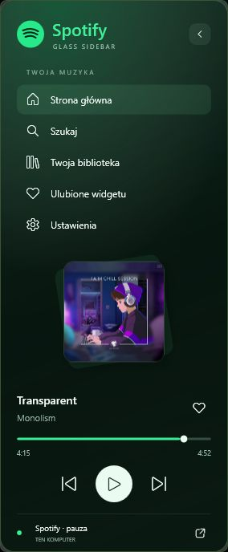

# Spotify Glass Sidebar

**Minimalistyczny widget Spotify dla Windows 11 — w dwóch trybach, z efektem szkła.**

Spotify Glass Sidebar to niezależna aplikacja desktopowa, która pokazuje aktualny utwór i umożliwia sterowanie odtwarzaniem w aplikacji Spotify. Nie wymaga Rainmetera, logowania w widżecie ani konfiguracji Spotify Web API.

> **Projekt nieoficjalny.** Nie jest produktem Spotify i nie jest przez Spotify sponsorowany, zatwierdzony ani wspierany. Nazwa i znaki Spotify należą do ich właścicieli.

## Podgląd

<table>
  <tr>
    <th>Panel rozwinięty</th>
    <th>Pasek zwinięty</th>
  </tr>
  <tr>
    <td align="center"></td>
    <td align="center"></td>
  </tr>
</table>

## Funkcje

- **Dwa widoki:** pełny panel z okładką i kontrolkami oraz wąski, minimalistyczny pasek.
- **Informacje o muzyce:** tytuł, wykonawca, okładka, czas utworu i aktualny stan odtwarzania.
- **Sterowanie:** play/pauza, poprzedni/następny utwór i przewijanie za pomocą suwaka — w zakresie udostępnianym przez Spotify.
- **Wyszukiwanie i biblioteka:** przekierowanie do odpowiednich widoków Spotify.
- **Lokalne ulubione:** własna lista zakładek do utworów, niezależna od polubień na koncie Spotify.
- **Ustawienia wyglądu:** poziom przyciemnienia, animacja odtwarzania i opcja „zawsze na wierzchu”.
- **Wygoda:** przeciąganie, zwijanie, zasobnik systemowy i automatyczny zapis preferencji.

## Pobieranie i instalacja

**System:** Windows 11 x64. **Wymagane:** zainstalowane desktopowe Spotify.

1. Otwórz zakładkę **Releases** tego repozytorium i pobierz `SpotifyGlassSidebar-Windows11-x64-v1.0.0.zip`.
2. Wypakuj **cały archiwum ZIP** do zapisywalnego folderu, np. `Dokumenty\SpotifyGlassSidebar`.
3. Uruchom `app\SpotifyGlassSidebar.exe`.
4. Uruchom Spotify na tym komputerze i włącz dowolny utwór; widżet powinien rozpoznać lokalną sesję.

Program jest publikowany jako samodzielny plik wykonywalny z dołączonym środowiskiem .NET, więc użytkownik nie musi instalować .NET SDK. **Nie jest to instalator** — aplikacja nie tworzy autostartu ani nie modyfikuje konfiguracji systemu.

> Plik EXE nie jest podpisany certyfikatem wydawcy; Windows może ostrzec o nieznanym wydawcy. Pobieraj wyłącznie z zaufanego wydania tego projektu.

## Obsługa

| Czynność | Sposób |
| --- | --- |
| Zwiń / rozwiń | Strzałka na panelu / zielone logo na pasku; `Ctrl+B` w aktywnym oknie |
| Przenieś widget | Przeciągnij puste miejsce nagłówka (na pasku: przestrzeń nad/pod logo) |
| Play, pauza, zmiana utworu | Przyciski odtwarzacza |
| Przewiń utwór | Kliknij lub przeciągnij suwak |
| Wyszukaj | **Szukaj** → wpisz frazę → `Enter` |
| Zamknij panel wyszukiwania/ustawień | `Esc` |
| Ukryj / przywróć widget | Ikona w zasobniku systemowym |
| Zamknij aplikację | **Ustawienia**, menu ikony w zasobniku lub `Alt+F4` |

Pozycja, tryb paska, preferencje i ulubione są zapisywane w `app\data\settings.json`. Można przenieść je na inny komputer razem z folderem `data`. Autostart można skonfigurować ręcznie, dodając skrót do programu do folderu autostartu Windows.

## Ograniczenia

Widget korzysta z **lokalnej sesji multimedialnej Windows**, a nie ze Spotify Web API. Samo Spotify otwarte w przeglądarce nie jest obsługiwanym źródłem odtwarzania. Przy odtwarzaniu przez Spotify Connect na innym urządzeniu, reklamach, podcastach i treściach na żywo niektóre funkcje mogą działać inaczej.

„Ulubione widgetu” to **lokalne zakładki**, nie lista „Polubione utwory” w Spotify. Animowane słupki wskazują stan odtwarzania, ale nie analizują sygnału audio. Efekt Acrylic zależy od systemowych efektów przezroczystości. Program wyświetla własne okno, nie integruje się z panelem widżetów Windows.

Więcej szczegółów: [pełna instrukcja](docs/INSTRUKCJA.md).

## Testy

W dokumentacji dostarczonej z wersją **1.0.0**, zweryfikowanej **13 listopada 2026 r.** na Windows 11 x64 (build 26300), odnotowano **8/8 zaliczonych testów automatycznych** oraz pozytywne testy interfejsu i sterowania desktopową aplikacją Spotify. Nie wszystkie środowiska i warianty Spotify zostały przetestowane.

**Raport:** [TESTY.md](docs/TESTY.md) · **Wyniki testów jednostkowych:** [self-test.txt](docs/self-test.txt).

## Kompilacja ze źródeł

Kod projektu znajduje się w katalogu [`source/`](source/).

**Wymagania deweloperskie:** Windows 11 x64, PowerShell i odpowiedni .NET SDK. Wersja 1.0.0 oryginalnie celuje w **.NET 9**.

```powershell
# W katalogu głównym repozytorium
.\source\Build.ps1
```

Skrypt publikuje samodzielną aplikację do `app\SpotifyGlassSidebar.exe`. Samodzielny test w zbudowanej aplikacji można uruchomić przez:

```powershell
.\app\SpotifyGlassSidebar.exe --self-test
```

Wynik zostanie zapisany do `app\test-results\self-test.txt`. Skrypt budowania i kod w tym repozytorium pochodzą z dostarczonej wersji 1.0.0; nie zostały tutaj ponownie skompilowane ani zweryfikowane na Windows.

> **Uwaga dla deweloperów (listopad 2026):** wsparcie dla .NET 9 zakończyło się 10.11.2026. Przed publikacją nowej wersji zalecana jest migracja na **.NET 10 LTS** oraz ponowne testy aplikacji. Nie zmieniono docelowego frameworka w oryginalnym kodzie bez takiej weryfikacji. [Cykl wsparcia .NET](https://dotnet.microsoft.com/en-us/platform/support/policy/dotnet-core).

## Technologie

**C# · WPF · .NET 9 · Windows 11 x64**

- Odczyt multimediów: [Windows GlobalSystemMediaTransportControls](https://learn.microsoft.com/en-us/uwp/api/windows.media.control.globalsystemmediatransportcontrolssessionmanager).
- Systemowy efekt szkła: [DWM_SYSTEMBACKDROP_TYPE](https://learn.microsoft.com/en-us/windows/win32/api/dwmapi/ne-dwmapi-dwm_systembackdrop_type).
- Dystrybucja: `win-x64`, self-contained, single-file.

## Licencja i znaki towarowe

Kod źródłowy projektu jest udostępniany na warunkach [licencji MIT](LICENSE). Licencja nie daje praw do nazw ani znaków towarowych Spotify. Projekt nie jest powiązany ze Spotify AB.